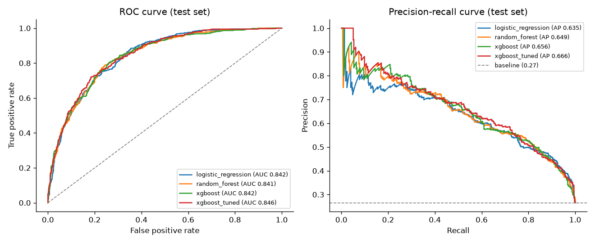
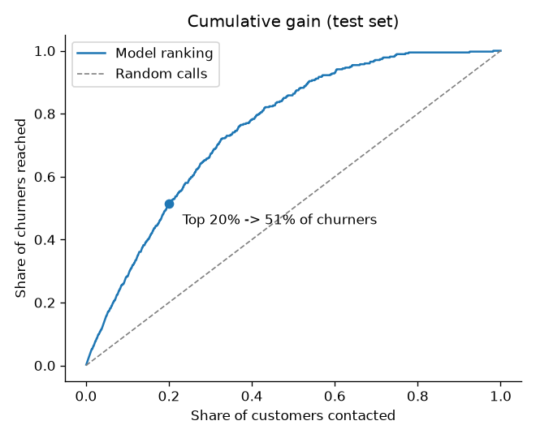
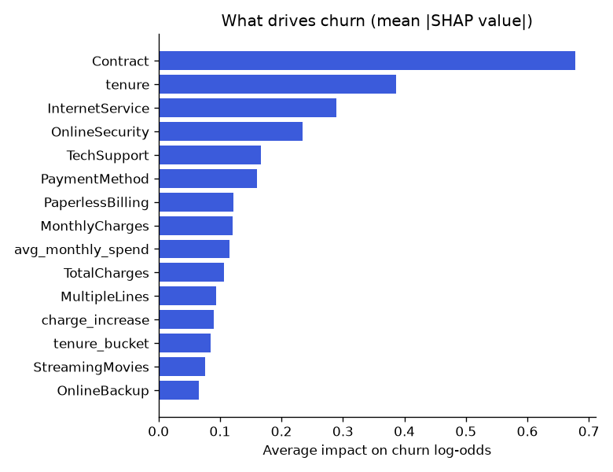
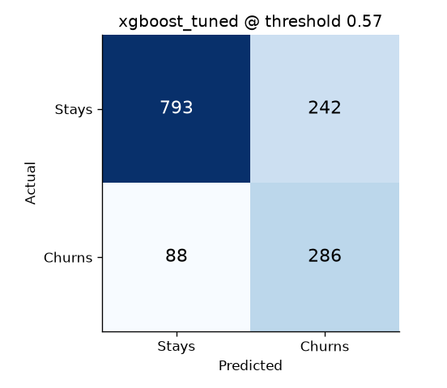

# ChurnGuard: Customer Churn Prediction & Explainability

[](https://github.com/Prashant-Best/churnguard/actions/workflows/ci.yml)


ChurnGuard predicts which telecom customers are about to cancel, **explains why** for each customer
with SHAP, and **suggests a retention action**. It ships as a REST API and an interactive dashboard
for a retention team.

> Calling the riskiest **20%** of customers reaches **51.3%** of everyone who is about to churn,
> about **2.6x** better than calling at random.

---

## Results

Trained on the [IBM Telco Customer Churn](https://github.com/IBM/telco-customer-churn-on-icp4d)
dataset: **7,043 customers, 26.5% churn**, stratified 80/20 split (5,634 train, 1,409 test).

| Metric (held-out test set) | Value |
|---|---|
| Selected model | **XGBoost (Optuna-tuned)** |
| ROC-AUC | **0.846** (Logistic Regression baseline 0.842) |
| PR-AUC | 0.666 (random = 0.265) |
| Decision threshold | 0.57 (chosen on out-of-fold training predictions for at least 75% recall) |
| Recall (churners caught) | **76.5%** |
| Precision | 54.2% |
| Churners reached in top 20% | **51.3%** |

**Model comparison** (5-fold stratified CV on the training set, then the test set):

| model               |   cv_roc_auc |   cv_pr_auc |   test_roc_auc |   test_pr_auc |   test_gain_top_20pct |
|:--------------------|-------------:|------------:|---------------:|--------------:|----------------------:|
| xgboost_tuned       |       0.8495 |      0.6644 |         0.8457 |        0.6661 |                0.5134 |
| logistic_regression |       0.8455 |      0.6598 |         0.8418 |        0.6352 |                0.4947 |
| random_forest       |       0.8444 |      0.6541 |         0.8406 |        0.6486 |                0.4947 |
| xgboost             |       0.8414 |      0.6524 |         0.8415 |        0.6560 |                0.5080 |

All models land close together: contract type and tenure carry most of the signal, so a linear
model already captures much of it. Model selection uses CV ROC-AUC only; the test set is used once.

| ROC and precision-recall curves | Cumulative gain |
|---|---|
|  |  |
| **What drives churn (SHAP)** | **Confusion matrix at the chosen threshold** |
|  |  |

### Key findings from the [EDA notebook](notebooks/01_eda.ipynb)
- **Contract** is the strongest signal: month-to-month customers churn at **42.7%**, two-year at **2.8%**.
- **Tenure**: 52.9% churn in the first 6 months, 9.5% after 4 years.
- **Electronic check** payers churn at 45.3%, about 3x automatic payers.
- **Fiber optic** customers churn at 41.9% vs 19.0% for DSL, a possible price or quality issue.
- Customers **without tech support or online security** churn at about 42% vs 15% with them.

---

## What it does

- **End-to-end pipeline**: cleaning, feature engineering and encoding live in one scikit-learn
  `Pipeline`, so training and serving can never drift apart and CV has no leakage.
- **Model comparison**: Logistic Regression, Random Forest and XGBoost with stratified 5-fold CV,
  class-imbalance handling (`class_weight`, `scale_pos_weight`).
- **Hyperparameter tuning** with Optuna (TPE sampler), scored by cross-validation.
- **Threshold tuning** for the business goal (catch at least 75% of churners) instead of 0.5.
- **Experiment tracking** with MLflow: every run's parameters, metrics and figures.
- **Explainability**: SHAP values per customer, with one-hot columns grouped back into readable
  features ("Contract", not "Contract_Month-to-month").
- **Actionable output**: risk band (low/medium/high), top 3 reasons and a retention offer.
- **FastAPI service** with Pydantic validation, batch scoring and OpenAPI docs.
- **Streamlit dashboard**: risk overview, customer drill-down, what-if simulator, model report.
- **Engineering**: 39 pytest tests, ruff linting, Docker, GitHub Actions CI with a container smoke test.

## Architecture

```
data/raw/telco_churn.csv
        │
        ▼
churnguard.data       clean() + validate()  ── single source of truth for the schema
        │
        ▼
churnguard.features   FeatureEngineer ─► ColumnTransformer (scale + one-hot)
        │
        ▼
churnguard.models     LogisticRegression │ RandomForest │ XGBoost (+ Optuna)
        │
        ▼
churnguard.train      CV ─► tuning ─► threshold ─► test ─► SHAP ─► save   ──► MLflow, reports/
        │
        ▼
models/churn_model.joblib   {pipeline, threshold, SHAP background, metadata}
        │
        ▼
churnguard.predict    ChurnPredictor: probability, risk, top-3 reasons, action
        │                         │
        ▼                         ▼
app/api.py (FastAPI)      app/dashboard.py (Streamlit)
```

## Project structure

```
churnguard/
├── app/                  api.py (FastAPI), dashboard.py (Streamlit)
├── configs/config.yaml   all settings: split, CV, tuning, threshold, tracking
├── data/                 raw/ (downloaded, git-ignored), sample/ (demo customers)
├── models/               trained model artifact
├── notebooks/            01_eda.ipynb
├── reports/              metrics.json, model_comparison, figures/
├── scripts/              download_data.py
├── src/churnguard/       data, features, models, train, evaluate, explain, predict
├── tests/                pytest suite (synthetic data, no download needed)
├── Dockerfile, docker-compose.yml, .github/workflows/ci.yml
└── requirements.txt (serving), requirements-dev.txt (training + tests)
```

## Quick start

```bash
git clone https://github.com/Prashant-Best/churnguard.git
cd churnguard
python -m venv .venv
.venv\Scripts\activate          # macOS/Linux: source .venv/bin/activate
pip install -r requirements-dev.txt
pip install -e .

python scripts/download_data.py
python -m churnguard.train      # ~3 min; add --trials 10 for a quick run
pytest
```

**Run the API** at http://localhost:8000/docs

```bash
uvicorn app.api:app --reload
```

**Run the dashboard** at http://localhost:8501

```bash
streamlit run app/dashboard.py
```

**See experiments in MLflow**

```bash
mlflow ui --backend-store-uri sqlite:///mlflow.db
```

**Run both with Docker**

```bash
docker compose up --build
```

## API

| Method | Endpoint | Description |
|---|---|---|
| GET | `/health` | Service and model status |
| GET | `/model/info` | Model name, threshold and test metrics |
| POST | `/predict` | Score one customer |
| POST | `/predict/batch` | Score up to 1,000 customers |

Example request:

```bash
curl -X POST http://localhost:8000/predict -H "Content-Type: application/json" -d '{
  "customerID": "7590-VHVEG", "gender": "Female", "SeniorCitizen": 0, "Partner": "Yes",
  "Dependents": "No", "tenure": 1, "PhoneService": "No", "MultipleLines": "No phone service",
  "InternetService": "DSL", "OnlineSecurity": "No", "OnlineBackup": "Yes",
  "DeviceProtection": "No", "TechSupport": "No", "StreamingTV": "No", "StreamingMovies": "No",
  "Contract": "Month-to-month", "PaperlessBilling": "Yes", "PaymentMethod": "Electronic check",
  "MonthlyCharges": 29.85, "TotalCharges": 29.85}'
```

Example response:

```json
{
  "customerID": "7590-VHVEG",
  "churn_probability": 0.8647,
  "will_churn": true,
  "risk_level": "high",
  "threshold": 0.5657,
  "top_reasons": [
    {
      "feature": "tenure",
      "value": "1",
      "impact": 0.771,
      "direction": "increases_risk"
    },
    {
      "feature": "Contract",
      "value": "Month-to-month",
      "impact": 0.4649,
      "direction": "increases_risk"
    },
    {
      "feature": "InternetService",
      "value": "DSL",
      "impact": -0.3257,
      "direction": "decreases_risk"
    }
  ],
  "suggested_action": "Enrol the customer in the new-customer onboarding and loyalty programme."
}
```

Invalid input (an unknown contract type, negative tenure, a missing field) returns **422** before
reaching the model. If the model file is missing, the API starts in a degraded state and returns **503**.

## Design decisions

| Decision | Why |
|---|---|
| Blank `TotalCharges` set to 0 | All 11 blanks are tenure-0 customers who were never billed; mean imputation would invent a bill |
| One `Pipeline` for features + model | No leakage in CV; identical transformations in training and serving |
| Stratified split and CV | Keeps the 26.5% churn ratio in every fold |
| Class weights instead of SMOTE | Same effect without synthetic customers or resampling leakage |
| Threshold from out-of-fold predictions | Choosing it on the test set would leak and inflate results |
| ROC-AUC, PR-AUC, recall, gain | Accuracy is misleading: "nobody churns" scores 73.5% |
| XGBoost native `pred_contribs` for SHAP | Exact TreeSHAP values, fast, no extra dependency at serving time |
| One schema list shared by data validation and the API | A test fails if they ever drift apart |

## Limitations and next steps

- **Calibration**: class weighting inflates probabilities. Calibrate before using them as true
  probabilities (e.g. expected revenue at risk).
- **Cost-based threshold**: replace the recall target with real campaign costs and customer value.
- **Uplift modelling**: target customers who will *respond* to an offer, not only those likely to churn.
- **Monitoring**: track data drift (PSI) and live churn rate; retrain on schedule or on alerts.
- **Feedback loop**: keep a random hold-out group without offers so future labels stay unbiased.
- **Security**: add API authentication and rate limiting before any real deployment.

## Tech stack

Python · pandas · scikit-learn · XGBoost · Optuna · SHAP · MLflow · FastAPI · Pydantic · Streamlit ·
Plotly · pytest · ruff · Docker · GitHub Actions

---

Built by **Prashant Panwar**, B.Tech CSE (Minor: Data Science), Lovely Professional University.
